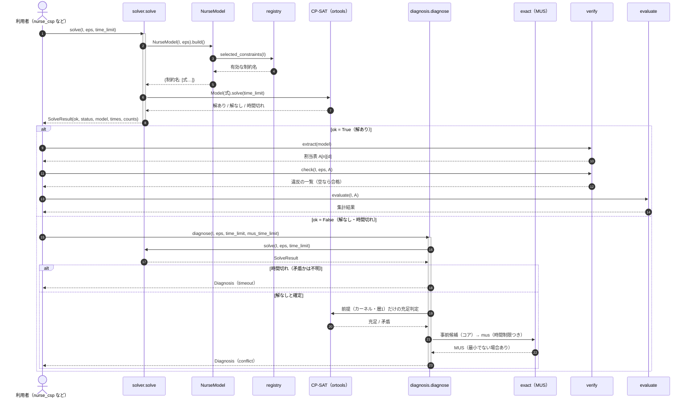
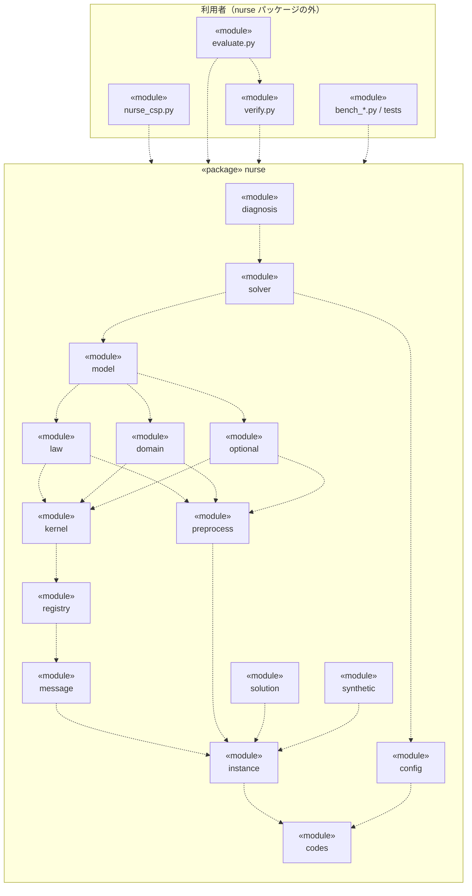

# ナーススケジューリング CSP エンジン

看護師の勤務表を、制約充足問題（CSP）として解くエンジン。CPMpy と OR-Tools CP-SAT を使い、**目的関数を持たず**、すべての制約を満たす勤務表を1つ見つける。法令・診療報酬・ガイドラインに由来する制約を、**3つの層**（変えられるかどうかで分けたもの）に整理している。

| 項目 | 内容 |
|---|---|
| 解く問題 | 看護師 N 人・T 日の勤務表（休・日勤・準夜・深夜・パート勤務など）。履歴（前月末の勤務）を引き継ぐ |
| 定式化 | 純PB（決定変数・補助変数はすべて Boolean、整数係数の線形制約）。品質要件は ε 制約で表す |
| ソルバー | **求解は CP-SAT、MUS（矛盾の説明）は exact**（決定事項。CPMpy 経由）。`exact`・`pysat` は求解でも指定できるが実験用 |
| 検証 | 独立検証器 `verify.py` が、モデルの式を使わずに元の規則で解を検査する |
| 規模の目安 | 合成データで 30人・31日が約3秒、60人・31日が約20秒（`bench_scale.py` の計測。制約の構成で大きく変わる） |

## 目次
1. [クイックスタート](#1-クイックスタート)
2. [プロジェクト構造](#2-プロジェクト構造)
3. [アーキテクチャ](#3-アーキテクチャ)
4. [使い方](#4-使い方)
5. [制約を足すには](#5-制約を足すには)
6. [テストと検証](#6-テストと検証)
7. [計測スクリプト](#7-計測スクリプト)
8. [設計方針](#8-設計方針)
9. [既知の制限](#9-既知の制限)
10. [用語集](#10-用語集)
11. [Claude Code で使う](#11-claude-code-で使う)

---

## 1. クイックスタート

```bash
python -m venv .venv && source .venv/bin/activate      # Windows: .venv\Scripts\activate
pip install -r requirements.txt                        # cpmpy, ortools, exact, numpy, pytest, pyyaml

python nurse_csp.py            # 合成インスタンス（30人・30日）を1問求解し、勤務表の先頭を表示
python evaluate.py             # 求解 → 独立検証 → 評価（人数・勤務回数・72時間・土日・要望）を表示
pytest -q                      # 全テスト（124件、約1分40秒）
```

どちらのスクリプトも `--lin`（`linearization_level`）と `--time-limit` を取る。`evaluate.py --requests 0.10` で個別要望を全セルの1割だけ加える。

---

## 2. プロジェクト構造

```
nurse-scheduling/
├── README.md               このファイル
├── CLAUDE.md               Claude Code 向けの文脈（設計方針・表記規約・制約の足し方）
├── requirements.txt
├── nurse.properties        設定ファイル（求解・MUS の時間制限。既定は各30秒）
│
├── nurse/                  エンジン本体（パッケージ）
│   ├── __init__.py         公開 API をまとめて再エクスポート
│   ├── codes.py            リターンコード（ReturnCode）と例外（InputError など）
│   ├── config.py           設定ファイル（properties）の読み込み
│   ├── instance.py         入力データ・層ごとのパラメータ・インスタンスへの単純な問い合わせ
│   ├── solution.py         解（割当表）の読み取り部品（検証器と評価が共有）
│   ├── preprocess.py       時刻データから係数・集合・窓を作る純Python（ソルバー不要）
│   ├── message.py          制約メッセージの構造化データ（対象・パラメータ）と整形器（日付・看護師名・区分名）
│   ├── registry.py         制約の登録（@constraint）、名前つき制約（Item/Aux/Named。ID・クラス名・メッセージ）、有効な制約の選択
│   ├── kernel.py           決定変数 x と式の部品、構造制約（scope=core）
│   ├── law.py              層1 労働法規の制約
│   ├── domain.py           層2 病院・看護職共通の制約
│   ├── optional.py         層3 努力義務・ガイドライン・個別要望の制約
│   ├── model.py            NurseModel（kernel + law + domain + optional の合成）
│   ├── solver.py           solve（SolveResult）・roster
│   ├── diagnosis.py        解けないときの診断（時間切れ / 制約矛盾 → MUS を日本語で説明）
│   └── synthetic.py        合成インスタンス・個別要望の付与
│
├── nurse_csp.py            互換の窓口（`import nurse_csp as m`）と、1問求解の CLI
├── verify.py               独立検証器（制約名ごとの検査関数 CHECKS）
├── evaluate.py             解の評価（集計と表示）
│
├── bench_lin.py            linearization_level（0/1/2）の比較
├── bench_scale.py          規模（人数×日数）× lin の求解時間
├── bench_variants.py       対称性の除去 / 72時間ルール除外の効果
├── bench_requests.py       個別要望（休み要望・シフト要望）を足した影響
│
├── tests/
│   ├── test_preprocess.py  前処理の厳密性（総当たりと照合。ソルバー不要）        6件
│   ├── test_layers.py      層構成・根拠ID・休日の窓・検査関数の対応・パラメータ検証・取れない勤務への要望の検出  40件
│   ├── test_named.py       制約の名前（ID・クラス名・メッセージ・遅延生成・全群の一覧）・要望の一本化  17件
│   ├── test_message.py     整形器（日付・時刻・範囲・名前・パラメータ）と表示方針の検査  11件
│   ├── test_solve.py       求解 + 独立検証（制約を1つずつ外す求解を含む）           7件
│   ├── test_docs.py        README の依存表・依存図とクラス図が、コードと一致すること・ドキュメントサイトがビルドできること・API 文書が全モジュールを載せ docstring・型ヒントが揃い読みやすいこと  10件
│   ├── test_config.py      設定ファイル（properties）とリターンコード・例外・CLI の終了コード  17件
│   ├── test_diagnose.py    診断（時間切れ / 制約矛盾 / 前提同士の矛盾 / MUS が極小 / MUS の時間制限）  13件
│   └── test_evaluate.py    評価の集計が解と整合すること                              3件
│
├── docs/design/            設計の仕様
│   ├── constraint-message-spec.md  制約名・メッセージの仕様
│   └── class-diagram.md    クラス図（コア部分: IF・データモデル・数理モデル・求解エンジン）
├── docs/notes/             作業メモ（次のタスクの準備、調査結果、検討資料。サイトには載せない）
├── docs/api/               API リファレンス（モジュールごとに `::: モジュール名` だけを書く。中身は docstring から生成）
├── mkdocs.yml, tools/mkdocs_hooks.py, requirements-docs.txt, .github/workflows/docs-site.yml
│                           ドキュメントサイト（README と docs/ をそのまま MkDocs でビルド。公開しない。4.7 節）
│
└── docs/legal/             法令・基準の調査（制約の根拠・確度・実装状況）
    ├── README.md           この調査の使い方、区分と確度の凡例
    ├── constraints.yaml    制約32件の機械可読な一覧（id・区分・確度・対応するモデルの制約名・実装状況）
    ├── 01_law.md           A 法令（労基法・育児介護休業法・安衛則）
    ├── 02_reimbursement.md B 診療報酬の施設基準 / C 医療法の人員標準
    ├── 03_guidelines.md    D 努力義務・日本看護協会ガイドライン
    ├── 04_model_mapping.md 現行モデルとの対応と未実装の一覧
    └── 05_sources_and_gaps.md  情報源と未確認事項
```

---

## 3. アーキテクチャ

### 3.1 データの流れ

**① 図（UML シーケンス図）**



**② 説明**

| 登場者 | 実体 | 役割 |
|---|---|---|
| 利用者 | `nurse_csp.py`、テスト、利用者のコード | 求解・診断・検証・評価を順に呼ぶ |
| `solver.solve` | `nurse/solver.py` | 式を作り、CP-SAT に渡して解き、`SolveResult` を返す |
| `NurseModel` | `nurse/model.py` | 有効な制約ごとに式を生成する（`build`） |
| `registry` | `nurse/registry.py` | `Rules.off`・`enabled` を反映して、有効な制約名を選ぶ |
| CP-SAT | OR-Tools（CPMpy 経由） | 求解と、充足判定 |
| `diagnosis.diagnose` | `nurse/diagnosis.py` | 解けない原因を「時間切れ」と「制約矛盾」に分け、矛盾なら MUS を求める |
| exact | PB ソルバー exact（CPMpy 経由） | 矛盾の原因（MUS）の計算 |
| `verify` / `evaluate` | `verify.py` / `evaluate.py` | 解の独立検査 / 解の集計 |

図の番号に沿った流れ:

- **1〜8 求解**: `solve` が `NurseModel` を作り（2）、`registry` が有効な制約を選ぶ（3〜4）。制約名ごとの式の辞書（5）を CP-SAT に渡して解き（6〜7）、`SolveResult(ok, status, model, times, counts)` を返す（8）。計時は `build`（式の生成）・`transform`（CPMpy からソルバーへの変換）・`solve`（求解）の3つに分けて `times` に入る。
- **9〜14 解あり（`ok = True`）**: モデルから割当表 `A[n][d]`（勤務の添字）を取り出し（9〜10）、独立検証器で検査する（11〜12。モデルの式を使わず、元の規則から直接数える）。続けて評価（集計）を行う（13〜14）。
- **15〜23 解なし・時間切れ（`ok = False`）**: `diagnose` は `solve` をもう一度呼ぶ（16〜17。通常求解の結果は再利用しない）。
  - 時間切れなら、矛盾かどうかは不明なので MUS を求めず `Diagnosis(timeout)` を返す（18）。前提だけの充足判定（19）が時間切れになった場合も、同じく `Diagnosis(timeout)` を返す（図では省略）。
  - 解なしと確定したら、前提（カーネル・層1）だけの充足判定を行い（19〜20）、矛盾の原因（MUS）を求める（21〜22）。MUS は2回求める（まず外せる制約（層2・層3）の MUS、次にその矛盾に関わる前提の絞り込み）。いずれも、まず仮定つきの求解で事前候補（コア）を取り、`mus` を時間制限つきで実行する。時間内に終われば最小、打ち切れば事前候補を返す（`minimal=False`）。結果は `Diagnosis(conflict)`（23）で、`explain()` が日本語で説明する。
- **図で省いたこと**: 前提だけで矛盾する場合（`hard_only`）は、MUS を前提の中から求める。この分岐は図に描いていない。時間制限（`time_limit`・`mus_time_limit`）の既定値は `nurse.properties` から読む（4.6 節）。
- **記法**: 実線の矢印は呼び出し、破線の矢印は戻り値、`alt` は条件分岐、縦長の箱は実行中（活性区間）を表す。

### 3.2 層構成（制約の分け方）

制約を「誰が切り替えられるか」で4つの適用範囲（`scope`）に分ける。

| 層 | `scope` | 切り替え | 中身 | パラメータ |
|---|---|---|---|---|
| カーネル | `core` | 常に有効 | 1日1勤務、履歴、固定割当 | — |
| 層1 労働法規 | `law` | **オフにできない** | 週1休・4週4休（労基法35条） | `LawParams` |
| 層2 病院・看護職共通 | `domain` | 病院が選ぶ | 人数、夜勤リーダー、公休数、72時間ルール | `DomainParams` |
| 層3 任意 | `optional` | クライアントが選ぶ | 勤務間隔、連続勤務、夜勤回数、土日、要望 | `GuidelineParams`、`Eps` |

- カーネルと層1を外そうとすると `InputError`（`ValueError` の一種）になる。層2・層3は `Rules.off` に制約名を入れて外す。
- 制約は下の層に「加える」（論理積）ので、上の層が下の層を弱めることはない。
- `layer`（L1〜L5）は**式の作り方**の分類（構造・系列・個人・横断・規制）で、`scope` とは別の軸。

### 3.3 登録されている制約（17群）

| `scope` | 制約名 | 内容 | 根拠ID（`docs/legal/constraints.yaml`） |
|---|---|---|---|
| core | `struct` | 各看護師・各時点でちょうど1つの勤務 | — |
| core | `history` | 前月末の実績を固定 | — |
| core | `fixed` | 確定休・有休などの固定割当（有休は利用者が入力した取得日のみ。日数は管理しない） | LAW-PAID-LEAVE |
| law | `holiday` | 週1回以上、または4週で4日以上の休日。有休は休日に数えない | LAW-HOLIDAY |
| domain | `offcount` | 公休数が決められた日数 | — |
| domain | `cover` | 時間帯ごとの必要人数（30分スロットと同値な区間制約） | REIMB-NIGHT-2 |
| domain | `skill` | 準夜・深夜ごとに夜勤リーダー資格者が1人以上 | — |
| domain | `72h` | 月平均夜勤時間が72時間以下（算入者の平均） | REIMB-72H ほか |
| optional | `rest` | 勤務間隔 11時間以上 | GL-REST-11H |
| optional | `consec` | 連続勤務 5日以内 | GL-CONSEC-WORK |
| optional | `offblock` | 休みの連続日数の下限（既定は無効） | — |
| optional | `weekend` | 勤務する週末が3回以内 | GL-WEEKEND |
| optional | `night_band` | 夜勤回数を平均付近の帯に収める | GL-NIGHT-COUNT |
| optional | `weekend_spread` | 土日勤務日数の max−min を区分内で2以内 | — |
| optional | `req_off` / `req_shift` | 休み要望（希望休を含む）・シフト要望の違反割合に上限 | — |
| optional | `sym_break` | 同種の看護師の夜勤回数を整列（実験用、既定は無効） | — |

### 3.4 モジュールの依存（下向きのみ）

**① 図（UML パッケージ図に相当）**



Mermaid には UML のパッケージ図がないので、flowchart で UML の表記（`«package»`・`«module»`、破線の依存矢印）に合わせている。矢印は「依存する側 → 依存される側」（`import` している側から、されている側へ）。

**② 説明**

- **依存は下向きのみ**。循環はない。「段」の番号は、そのモジュールが依存する先をたどった最長の長さで、番号の大きいモジュールが小さいモジュールを使う（3.2 節の「層1〜3」＝制約の層とは別のもの）。循環がないことと、下の表が実際の `import` と一致することは、`tests/test_docs.py` が検査する。
- **図の矢印は、推移的に含まれる依存を省いている**（例: `law` は `registry` も直接 `import` するが、`kernel` 経由で到達できるので描かない）。省かない完全な直接依存は、下の表のとおり（`nurse` 内の依存は39本。図には、このうち20本を描いている）。
- `nurse_csp.py`・`verify.py`・`evaluate.py`・`bench_*.py`・テストは `nurse` パッケージ全体に依存する（`evaluate.py` は `verify.py` も使う）。
- `nurse/__init__.py` は、公開 API を再エクスポートするため全モジュールに依存する。図と表からは省いている。
- 外部ライブラリは、表の最後の列のとおり。CPMpy は制約を作るモジュール（`kernel`・`law`・`domain`・`optional`）と、求解・診断（`solver`・`diagnosis`）が使う。

| 段 | モジュール | 役割 | 直接の依存（`nurse` 内） | 外部ライブラリ |
|---|---|---|---|---|
| 0 | `codes` | リターンコード `ReturnCode` と例外（`InputError` など） | — | — |
| 1 | `config` | 設定ファイル `nurse.properties` の読み込み（`Settings`） | `codes` | — |
| 1 | `instance` | 入力データ `Instance`・層ごとのパラメータ・`Eps` | `codes` | numpy |
| 2 | `message` | 制約メッセージの部品と整形器 `Renderer` | `instance` | — |
| 2 | `preprocess` | 時刻データから係数・集合・窓を作る純Python | `codes`, `instance` | — |
| 2 | `solution` | 解（割当表）の読み取り部品 | `instance` | — |
| 2 | `synthetic` | 合成インスタンス・個別要望の付与 | `instance` | numpy |
| 3 | `registry` | `@constraint` の登録、名前つき制約（`Item`・`Aux`・`Named`）、有効な制約の選択 | `codes`, `instance`, `message` | cpmpy |
| 4 | `kernel` | 決定変数 `x` と式の部品、構造制約（`ModelKernel`） | `codes`, `instance`, `message`, `registry` | cpmpy |
| 5 | `domain` | 層2 病院・看護職共通の制約（`DomainConstraints`） | `instance`, `kernel`, `message`, `preprocess`, `registry` | cpmpy |
| 5 | `law` | 層1 労働法規の制約（`LawConstraints`） | `codes`, `kernel`, `message`, `preprocess`, `registry` | cpmpy |
| 5 | `optional` | 層3 努力義務・要望の制約（`OptionalConstraints`） | `instance`, `kernel`, `message`, `preprocess`, `registry` | cpmpy |
| 6 | `model` | `NurseModel`（上の3つの合成） | `domain`, `law`, `optional` | — |
| 7 | `solver` | `solve`・`SolveResult`・`roster` | `config`, `instance`, `model` | cpmpy, numpy |
| 8 | `diagnosis` | 解けないときの診断（`diagnose`・`Diagnosis`） | `codes`, `config`, `instance`, `registry`, `solver` | cpmpy |

### 3.5 クラス図（コア部分）

コア部分（IF・データモデル・数理モデル・求解エンジン）のクラス図は、`docs/design/class-diagram.md` にまとめている（Mermaid、5枚）。

| 図 | 内容 |
|---|---|
| 図1 全体像 | 4つの領域の主なクラスと、領域をまたぐ関係 |
| 図2 データモデル | `Instance`・`ShiftDef`・`Rules`・各 `Params`・`Eps` |
| 図3 数理モデル | `ModelKernel`・ミックスイン・`NurseModel`・登録の仕組み（`ConstraintSpec`・`Item`・`Aux`・`Named`）・`Renderer` |
| 図4 求解エンジン | `solver`・`SolveResult`・`diagnosis`・`Diagnosis` と外部ソルバー |
| 図5 IF | `nurse_csp`・設定（`Settings`）・戻り値（`ReturnCode`）・例外・`verify`・`evaluate` |

---

## 4. 使い方

### 4.1 求解 → 検証 → 評価

```python
from nurse import Eps, solve, synthetic
import verify, evaluate

I, eps = synthetic(), Eps()                   # 合成インスタンス（常勤26人・パート4人・30日）
res = solve(I, eps, time_limit=30)            # SolveResult。ok, status, model, times, counts = res とも展開できる
A = verify.extract(res.model)                 # 割当表 A[n][d]
print(verify.check(I, eps, A) or "OK")        # 独立検証（空リストなら全て充足）
evaluate.print_report(I, evaluate.evaluate(I, A))
```

### 4.2 層のパラメータを変える

```python
import dataclasses as dc
from nurse import Rules, LawParams, DomainParams

# 層1: 休日を「4週4日以上」に（労基法35条2項）
law = dc.replace(I.rules.law, holiday_rule="4w4d")
# 層2: 入院基本料を「その他」に（72時間ルールの算入閾値が 16h → 8h 未満除外に）
domain = dc.replace(I.rules.domain, admission_class="other")
# 層2・層3の制約をオフに（層1・カーネルは指定できず InputError）
J = dc.replace(I, rules=dc.replace(I.rules, law=law, domain=domain, off=frozenset({"72h", "rest"})))

res = solve(J, eps)
verify.check(J, eps, verify.extract(res.model))   # オフにした制約の検査は自動で飛ばす
```

### 4.3 勤務者からの要望を足す

勤務者からの要望は2種類で、どちらも**守れなくてもよい（soft）が、違反は要望数の割合 ρ まで**（ε制約）。

| 種類 | 入力 | 内容 |
|---|---|---|
| **休み要望**（希望休を含む） | `Instance.req_off`（`{看護師: [日]}`） | その日を「休」にしたい |
| **シフト要望** | `Instance.req_shift`（`{看護師: [(日, 勤務)]}`） | その日をその勤務にしたい（取れない勤務を指定すると `InputError`） |

- 希望休と休み要望は同じもの（勤務者からの「休みたい」）なので、`req_off` に一本化している。以前の件数指定（`soft_off`・κ=10件）は廃止した。
- 守る量は割合 ρ（`Eps.req_viol_ratio`、既定 0.3）だけで決まる。**充足率 = 1 − ρ が下限の保証**で、目的関数がないため、実際の充足率は下限ちょうどになりやすい（9 章）。
- **有休は要望ではない**。取得日は利用者が管理し、入力した日を固定割当（`fixed`、必ず守る）として受け取る。

```python
from nurse import with_requests
K = with_requests(I, rate=0.10, seed=0)       # 全セルの1割を、休み要望とシフト要望に半々で追加（元の要望は残る）
eps = Eps(req_viol_ratio=0.3)                 # 各要望の違反を30%まで許容
```

### 4.4 解けないとき

解けない原因は2つある。

| 原因 | 意味 | 診断 |
|---|---|---|
| 時間切れ | 解も、解が無い証明も得られなかった。制約矛盾かどうかは不明 | `status == "timeout"`。time_limit を延ばす、規模や重い条件を見直す |
| 制約矛盾 | 解が無いと証明できた | `status == "conflict"`。同時には成り立たない最小の制約の集合（MUS）を日本語で説明する |

```python
from nurse import diagnose, precheck
precheck(I, eps)                       # 必要条件の集計検査（需要 > 供給可能 の日を返す。速い）
d = diagnose(I, eps, time_limit=30)    # Diagnosis。d.status は "feasible" / "timeout" / "conflict"
print(d.explain())                     # 日本語の説明
d.items, d.soft_items, d.given_items   # MUS の全体 / 外せる制約（層2・3）/ 前提の制約（カーネル・層1）
d.hard_only                            # True なら前提同士（入力データと法令）の矛盾
```

**hard と soft の分け方**（MUS に別々に渡す）:

| 区分 | 該当する制約 | 説明での扱い |
|---|---|---|
| 背景（hard） | 構造・履歴・補助変数の定義（`relaxable=False` と `Aux`） | 出さない（常に成り立つ） |
| 前提（hard） | カーネル・層1: 固定割当、労基法の休日（オフにできない） | 矛盾に関わるものだけ「前提」として出す |
| soft | 層2・層3: 人数、公休数、72時間、勤務間隔、連続勤務など（外せる） | 「矛盾の原因」として出す |

説明の例（看護師3を6日目から7日間ずっと日勤に固定した場合。固定割当は前提、連続勤務は soft。開始日 11/02 を指定）:

```
■ 前提としている制約（オフにできない。カーネル・層1）（6件）
  fixed-0008  [固定割当] N03 11/07 勤務=日
  ...（11/12 まで）
■ 矛盾の原因になっている制約（外せる。層2・層3）（1件）
  consec-0101  [連続勤務日数上限] N03 11/07 - 11/12 連続勤務日数=5
■ 対処
  - 外せる制約（consec）は、パラメータ（需要・上限など）の調整か、Rules.off での除外で緩められます。
  - 前提の制約（fixed）はオフにできません。入力データ（固定割当など）を見直す手もあります。
```

前提同士の矛盾（固定割当 × 週1休。連続勤務をオフにした場合）は、soft が空になるので「オフにできない制約同士（入力データと法令）」として、前提の中から MUS を説明する（`hard_only=True`）。

MUS の求め方:
- `cpmpy.tools.mus` を PB ソルバー **exact** で使う（決定事項。CP-SAT より速い。4.5 節）。exact が使えないときは、黙って別のソルバーに替えず、導入方法つきのエラー（`pip install exact`）にする。
- 手順: ①前提だけで矛盾するか調べる（矛盾するなら前提の中から MUS）。②そうでなければ soft の MUS を**一段階**で求める（hard は仮定を持たず別に渡す）。③その矛盾に関わる前提だけを追加で絞る。
- CPMpy は制約式に名前を付けられないので、制約メソッドが式を `Item(式, 対象, パラメータ)` や `Aux(補助変数の定義式)` で包んで返し、`build_named()` が `Named` に正規化する。MUS が返す式を、式の同一性で引き戻して名前を得る。

**制約の名前（ID・クラス・メッセージ）**（仕様: `docs/design/constraint-message-spec.md`）

| 項目 | 内容 | 例 |
|---|---|---|
| ID | `{群}-{群内連番4桁}`。全制約で一意。同じ入力なら同じ ID | `cover-0012` |
| 制約クラス（群） | `@constraint` の登録名 | `cover` |
| クラス名 | 日本語・短い（片側の群は方向を含む） | `人数制約下限` |
| メッセージ | `<対象> <名前>=<値>`。構造化データから整形器が、診断のときだけ作る | `11/03 12:30 - 11/03 13:00 勤務者数=10` |

表示行は `{ID}  [{クラス名}] {メッセージ}`。日付は `Instance.start_date` を指定すると `MM/DD HH:mm`（時間帯は `MM/DD HH:mm - MM/DD HH:mm`、24:00 は翌日の 00:00）、未指定なら `1日目(月) 08:30` の形。看護師名・勤務区分名は `Instance.nurse_names`・`cat_names` で渡す（未指定なら `N05` と既定の区分名）。

### 4.5 MUS ソルバーの比較（exact と CP-SAT）

現行の `diagnose`（一段階、カーネル・層1も hard）で、`mus_solver` を exact と CP-SAT にして比べた実測。合成データ（seed 0、30日、常勤:パート = 26:4）、各3回の中央値、1回あたり 300秒で打ち切り。数字は診断のうち MUS の計算時間（前提だけで矛盾しないかの判定を含む）で、通常の求解（約0.1秒）は含まない。

| 矛盾の種類（MUS の件数） | 30人 exact | 30人 CP-SAT | 60人 exact | 60人 CP-SAT |
|---|---|---|---|---|
| A 公休数が日数を超える（1件 = soft 1） | 2.5秒 | 4.2秒 | 7.8秒 | 10.0秒 |
| C 固定割当の連続 × 連続勤務（7件 = 前提6 + soft 1） | 2.4秒 | 5.0秒 | 8.9秒 | 11.9秒 |
| D 固定割当の連続 × 週1休（8件 = 前提同士） | 0.6秒 | 1.8秒 | 1.1秒 | 3.6秒 |
| F 固定割当 × 勤務間隔（3件 = 前提2 + soft 1） | 2.3秒 | 4.2秒 | 7.8秒 | 10.3秒 |
| G 固定割当 × 勤務週末数（5件 = 前提4 + soft 1） | 2.7秒 | 4.6秒 | 9.1秒 | 11.1秒 |
| H 固定割当 × 夜勤回数（10件 = 前提9 + soft 1） | 2.5秒 | 6.0秒 | 8.4秒 | 13.0秒 |
| B 需要が3倍（2件 = 前提1 + soft 1） | 2.6秒 | 4.1秒 | 8.2秒 | 10.2秒 |

- **exact は、14条件すべてで CP-SAT より速い**（1.2〜3.3倍、中央値 1.6倍）。全84回が「制約矛盾」と判定され、exact と CP-SAT で MUS（制約群・件数・種別）が一致した。
- **60人では差が小さい**（1.2〜1.6倍。D だけ 3.2倍）。D は前提同士の矛盾で計算量が小さく、固定費の差が出やすい。
- **時間の大半は soft の MUS**（60人で 7.3〜8.3秒）。前提の絞り込みは 0.4〜1.1秒。
- **MUS は一意ではなく、hard / soft の分け方に依存する**。B の MUS は、旧い分け方（固定割当も soft）では人数制約3件だったが、現行では固定割当1件 + 人数制約1件（固定割当を前提にしたため）。
- **比較から除外した条件**: 72時間ルールの上限を極端に下げた矛盾（平均夜勤20時間以下）。この制約を外さない限り、他のどの制約を外しても実行不能のままなので、MUS の絞り込みが全探索に近くなり、exact でも終わらなかった（比較に不向きな条件設定）。平均値の制約は求解でも重い（72時間ルールを外すと求解が約6分の1）。現実的な上限での挙動は未測定。
- 人数制約のメッセージは、実際に効いている基本区間（勤務の境で区切った小区間）と勤務者数で表す（需要区間は出さない）。基本区間は統合しない（制約の区間と表示が常に一致する）。`Instance.demand` は番ごとに一定で、各日を空きなく覆う（生成時に検査）。

**旧い方式（二段階: 制約群 → 個別。hard は構造・履歴・補助変数のみ）での参考値**（現行の表ではない）:
- **二段階と一段階の比較**（exact、各2回）: 一段階が二段階以下だったのは 12/12 条件（0.58〜0.95倍。例: 30人の F は 3.2秒 → 2.3秒、60人の C は 13.2秒 → 8.2秒）。二段階に優位性は見つからなかったので、現行は一段階。
- **旧い二段階では、B の CP-SAT は群単位の MUS が300秒でも終わらなかった**が、現行の一段階では 4.1秒（30人）で終わる。CP-SAT の性能ではなく、二段階の「群を論理積にした単位」の定式化に起因していたとみられる（切り分けは未実施）。
- **差の要因**（30人、旧い方式での分解計測と、D のモデルサイズ・CP-SAT 設定の実験）:
  - ソルバーの呼び出し回数と、最初に得られるコアの大きさは、両ソルバーで同じ。差は回数ではなく、1回あたりの時間と構築時間にあった。
  - **CP-SAT は呼び出しごとにモデル全体を presolve し直す**（約1.1秒/回）。`cp_model_presolve=False` にすると、MUS の合計が 6.3秒→2.4秒になった（スレッド数は無関係）。それでも exact の約1.8倍。
  - **exact は1回あたりの時間がモデルの大きさにほぼ比例して減る**（連続勤務の群を外すと 0.28秒→0.07秒）。一方 CP-SAT は約1.5秒/回のまま。exact は式の変換（構築）が重く、小さなモデルでは合計の約6割を占める。
  - 矛盾そのものは易しい。hard と MUS だけのモデルは、どちらも1回 0.1〜0.2秒で解ける。

### 4.6 設定ファイルとリターンコード

**設定ファイル `nurse.properties`**（リポジトリ直下。Java 形式の `キー=値`、`#` でコメント）。時間制限を、コードを変えずに変更できる。

| キー | 既定 | 意味 |
|---|---|---|
| `solve.time_limit` | 30 | 求解（CP-SAT）の時間制限（秒） |
| `mus.time_limit` | 30 | MUS（矛盾の原因の絞り込み）1回あたりの時間制限（秒。soft の MUS と前提の MUS にそれぞれ） |

- `solve()`・`diagnose()` は、時間制限の引数（`time_limit`・`mus_time_limit`）を省略するとこの値を使う。引数で渡せば引数が優先する。CLI は `--time-limit`・`--mus-time-limit`。
- 読み込む場所は、先に見つかったもの: ①引数（CLI の `--properties`）、②環境変数 `NURSE_PROPERTIES`、③リポジトリ直下の `nurse.properties`（無ければ既定値）。①②で指定したファイルが無ければ、黙って既定値にせずエラーにする。
- 呼び出しのたびに読み直すので、ファイルを書き換えると次の呼び出しから反映される。未知のキー・重複・数でない値・正でない値は、ファイル名と行番号つきのエラー（`InputError`）。

**リターンコード**（`nurse/codes.py` の `ReturnCode`。`Diagnosis.code` と、CLI の終了コード）。

| コード | 名前 | 意味 | 区分 |
|---|---|---|---|
| 0 | `OK` | 正常完了（解が見つかった） | 正常 |
| 10 | `SOLVE_TIME_LIMIT` | 求解が時間切れ（解も矛盾の証明も得られなかった） | 時間打ち切り |
| 20 | `CONFLICT` | 制約矛盾（解なし。原因を最小まで特定） | 想定される結果 |
| 21 | `CONFLICT_MUS_TIME_LIMIT` | 制約矛盾（原因の絞り込みが時間切れ。事前候補を返した。最小でない可能性） | 時間打ち切り |
| 22 | `CONFLICT_UNIDENTIFIED` | 制約矛盾（証明済み。原因を時間内に特定できなかった） | 時間打ち切り |
| 30 | `INPUT_ERROR` | 入力・設定の誤り（`InputError`。`ValueError` の一種） | 異常 |
| 40 | `SOLVER_UNAVAILABLE` | ソルバー・実行環境が使えない（`SolverUnavailableError`。`RuntimeError` の一種。exact 未導入、fork が使えない） | 異常 |
| 50 | `INTERNAL_ERROR` | 内部エラー（`InternalError`。モデルの不具合、想定外の例外） | 異常 |
| 2 | （argparse） | CLI の引数の誤り。Python の慣習に従う | 異常 |

- 30 以上が異常（`ReturnCode.is_error`）。時間打ち切りと制約矛盾は、想定される結果として区別する。
- 例外は `NurseError` を基底とし、`code_of(例外)` でコードに変換できる。想定外の例外は 50。
- CLI は最後に `終了コード: 20 CONFLICT — …` を表示し、同じ値で終了する（`python nurse_csp.py; echo $?`）。

### 4.7 ドキュメントサイト（MkDocs。公開はしない）

README と `docs/design/`・`docs/legal/`、および **Python の API リファレンス**（`docs/api/`）を、MkDocs（Material テーマ）で1つのサイトにする。API リファレンスはソースの docstring から自動生成する（`mkdocstrings`。ソースを実行せず構文解析で読むので、cpmpy 等を入れなくてもビルドできる）。**docstring の書き方**（Markdown として表示される）:

- 先頭に「何をするか」を1行で書く。**引数がある関数は `Args:`、値を返す関数は `Returns:` の節**を、公開・内部（`_` で始まる）を問わず書く（Google 形式。API 文書で表になる。`property` は対象外。`tests/test_docs.py` が検査する）。型は、署名の型ヒントから表の「タイプ」欄に出る。
- 箇条書き・番号リスト・表・コードブロックの前には**空行**を入れる（無いと直前の段落に連結して1行に潰れる。`tests/test_docs.py` が検出する）。入れ子の箇条書きは4字下げる。
- `A[n][d]` のような角括弧を含む記号は、バッククォートで囲む（囲まないと相互参照とみなされ、`--strict` が失敗する）。
- クラスの項目（dataclass・NamedTuple・Enum）の説明は、項目の行末コメント `x: int  # 説明` に書く（`tools/griffe_comments.py` が API 文書の項目説明として表示する）。本文は今の Markdown をそのまま使い、サイト用の複製はない（README は `tools/mkdocs_hooks.py` がトップページとして組み込む）。作業メモ（`docs/notes/`）は載せない。

```bash
pip install -r requirements-docs.txt
mkdocs serve                  # http://127.0.0.1:8000 で確認（編集すると自動で更新）
mkdocs build --strict         # _site/ に出力。警告があれば失敗する（CI と同じ）
```

- **公開しない（決定事項）**: リポジトリは private のまま。標準の GitHub Pages は private でも**サイトがインターネットに公開される**（アクセス制限は Enterprise Cloud のみ）ため、Pages の公開は設定しない。`.github/workflows/docs-site.yml` はビルド検証（`--strict`）と、サイトの zip（成果物 `docs-site`、30日保存）の保存だけを行い、閲覧にはリポジトリの読み取り権限が要る。
- **公開したくなったとき**: Enterprise Cloud なら Pages のアクセス制御で private 公開できる。そうでなければ、ワークフローに `actions/upload-pages-artifact` と `actions/deploy-pages` のジョブを足し、Settings → Pages → Source を GitHub Actions にする。**足す前に公開範囲の確認が要る。**
- **モジュールを足したとき**: `docs/api/<モジュール名>.md` に `# \`名前\`` と `::: 名前` を書き、`mkdocs.yml` の nav に足す（足し忘れは `tests/test_docs.py` が検出する）。
- **用語**: *docstring* = 関数・クラスの先頭に書く説明文。*MkDocs* = Markdown から静的サイトを作るツール。*Material* = その見た目のテーマ（Mermaid の図もこれで描画される）。*`--strict`* = 警告（リンク切れなど）もエラー扱いにするビルド。

## 5. 制約を足すには

1. 該当する層のモジュール（`law.py` / `domain.py` / `optional.py`）に、`@constraint(名前, layer, relaxable, scope, source, title)` を付けたメソッドを書く。`list[Expression | Item | Aux]` を返し、補助変数はその中で作る。個別の規則は `Item(式, 対象, パラメータ)`（文字列は組み立てず、`message.py` の部品と `Param` を渡す）、補助変数の定義式は `Aux(式)` で包む。`title` は短い制約クラス名。
2. パラメータは `instance.py` の層ごとのデータクラスに足す（`__post_init__` で検証）。
3. `verify.py` に同名の検査関数を書き、`CHECKS` に登録する。式を使わず、元の規則から直接数える。
4. 前処理（窓・係数）が必要なら `preprocess.py` に純Pythonで書き、総当たりと照合するテストを足す。
5. 根拠があれば `docs/legal/constraints.yaml` に id を足し、`source` に指定する。

検査関数の足し忘れ、`source` が `constraints.yaml` に無い id、`constraints.yaml` の `model` が登録名に無いことは、`tests/test_layers.py` が検出する。詳しくは `CLAUDE.md`。

---

## 6. テストと検証

| ファイル | 件数 | 求解 | 見ているもの |
|---|---|---|---|
| `test_preprocess.py` | 6 | しない | 夜勤時間の係数、勤務間隔の閾値分解、人数制約の区間化が総当たりと完全一致。人数制約の区間が基本区間で重ならないこと、需要の入力検査 |
| `test_layers.py` | 40 | 一部 | 登録した制約と `constraints.yaml` の整合、オフにできない制約の保護、算入閾値、休日の窓（曜日7通り×起算2通り×日数2通り）、パラメータ検証、検査関数の対応、`night_band` オフ時の界、`SolveResult`、週末の定義、取れない勤務への要望が `InputError` になること |
| `test_solve.py` | 7 | する | 可解性と独立検証（`lin` 0/1）、層2・層3を1つずつ外した求解、休日の各規則、検証器が違反を検出すること |
| `test_named.py` | 17 | しない | `build` と `build_named` が同じ式、全群の短い一意なクラス名、**ID が全制約で一意・群内で連続**、補助変数・背景はメッセージなし、全 soft 制約のメッセージ、**メッセージの遅延生成**、全群のメッセージの一覧（開始日あり・なし）、人数制約が基本区間・翌日 00:00 で表れること、仕様書 8 節の表が実装の出力と一致すること |
| `test_message.py` | 11 | しない | 整形器: 日付（月・年またぎ、履歴の日）、時刻のゼロ埋め・翌日表記、時間帯の 24:00 → 翌日 00:00、看護師名・区分名、パラメータの書式、開始日と曜日の整合検査 |
| `test_docs.py` | 10 | しない | README 3.4 の依存表・依存図が実際の `import` と一致し循環がないこと、`class-diagram.md` のクラス図のフィールド・操作・戻り値・列挙値がコードと一致すること、ドキュメントサイトが警告なしでビルドでき図がすべて出力されること（MkDocs が無ければスキップ）、`docs/api/` が全モジュールを載せ nav に入っていること、公開の関数・クラスの docstring があること、全関数が `Args:`・`Returns:` を持つこと、全関数に型ヒントがあること、Markdown の崩れ（リスト・表の前の空行なし）が無いこと |
| `test_config.py` | 17 | 一部 | properties の書式と不正（行番号つき）・読み込みの優先順位、時間制限が設定ファイルで変わること、リターンコード全種と例外の対応、CLI の終了コード |
| `test_diagnose.py` | 13 | する | 時間切れは矛盾と区別、soft 単独の矛盾 / 前提に依存する矛盾 / **前提同士の矛盾**を日本語で説明、**MUS が充足不能かつ極小**（1件外せば解ける）、ソルバー選択（求解 CP-SAT・MUS exact）の固定、MUS ソルバー未導入時にエラーになること、**MUS の時間制限**（時間内に終われば最小 / 終わらなければ事前候補を返す / 事前候補も取れなければ特定不能） |
| `test_evaluate.py` | 3 | する | 評価の集計が解と整合、土日勤務日数のばらつき上限 |

解の正しさの根拠は `verify.check()` で、モデルの式（閾値分解・支配除去・片側定義・補助変数による窓）を使わず、勤務の時刻と元の規則から直接数える。

---

## 7. 計測スクリプト

| スクリプト | 比べるもの |
|---|---|
| `bench_lin.py` | `linearization_level` 0/1/2 × seed |
| `bench_scale.py` | 人数 30/60/90 × 日数 28/30/31 × lin |
| `bench_variants.py` | 基準 / 対称性の整列 / 72時間ルール除外 / 両方 |
| `bench_requests.py` | 個別要望の有無（`--seed`、`--rate`、`--ratio`） |

すべて各条件を複数回求解し、中央値・最小・最大と、解の検証結果を表示する。

---

## 8. 設計方針

変更する場合はユーザーに確認する（`CLAUDE.md` と同じ）。

- **目的関数なし**。品質要件は ε 制約（閾値つき制約）で表し、計算時間の最小化を優先する。
- **純PB**。`cp.intvar` は使わない。係数は整数のみ。
- **時刻は30分単位の整数**。0 = 当日0:00、48 = 翌日0:00。勤務は開始した暦日に属する。
- **勤務の値はデータ**（`ShiftDef`）。禁止遷移・人数・夜勤時間はすべて時刻から生成し、勤務名をコードに直書きしない（`"休"` のみ例外）。
- **x は疎**。看護師が取れる値についてだけ変数を作る。
- **有給休暇の日数は利用者が管理する**（決定）。システムは、入力された取得日だけを固定割当（hard）として受け取る。付与日数・比例付与・年5日の取得は検査しない。
- **制約は1定義＝1メソッド**で、副作用なし。
- **型ヒントは必須**。製品コード・ツール・テストの全関数で、`self` / `cls` 以外のすべての引数と戻り値に型を付ける（入れ子の関数も。`lambda` を除く）。制約メソッドの戻り値は `Constraints`（`nurse/registry.py`）。`tests/test_docs.py` が検査する。型の整合性は `mypy` で確かめられる（検査には使っていない。製品コードの指摘は0件。9 章）。
- **診断は別モデル**。通常の求解に指示変数を入れない。
- **週パターンの列挙は採用しない**（規模が約100倍になり、CSP ではLP緩和の利点が活きない）。

---

## 9. 既知の制限

- **型の整合性（`mypy`）**: 製品コードの指摘は0件（`mypy nurse verify.py evaluate.py nurse_csp.py tools --ignore-missing-imports --disallow-untyped-defs`。cpmpy は型情報を持たないため、式は `Expression` として扱う）。テストコードには12件の指摘が残る（`re.match(…).group` など、テストの書き方に由来するもの）。検査（CI）には入れていない。
- **要望の充足率は、下限（1 − ρ）ちょうどになりやすい**。目的関数がないため、ソルバーは「違反が上限以内」の解を1つ見つけて止まり、より多く守る努力をしない。30人・31日の合成データ（ρ=0.3）では、休み要望（希望休を含む）60件の違反が上限の18件に達して充足率70.0%、要望を追加した場合は休み要望106件が70.8%、シフト要望47件が70.2%だった（各1回の実測）。充足率を上げたいときは ρ を小さくする（下限が上がる）。件数指定（κ）をやめて割合に統一したため、基本の希望休（各人2日）の既定の下限は、以前の83.3%（10件以内）から70.0%（30%以内）に下がった。
- **合成データでの検証が中心です**。需要・確定休・履歴は乱数と手作りの値で、実在の病棟ではありません。
- **`night_band` をオフにすると求解が大幅に遅くなります**（72時間ルールの補助変数が全員分になる。30人・30日で 1.7秒 → 33秒、別の回は120秒でも未解決）。72時間ルールの界が `night_band` を前提にしているため、その前提が無いときは健全な式（補助変数が増える）を使う。
- **求解時間は規模より日数と72時間ルールで決まります**。同じ人数でも日数が1日増えると数倍になる条件がある。ワーカー数は複数並列で動くため、同じ条件でも試行ごとにばらつく。
- **休日の「暦日」の厳密解釈は未確認です**。`holiday_strict_calendar=True`（前日の勤務が日をまたぐ休を数えない）の解釈は、一次資料で確認していない。
- **法令・基準は一次資料で確認していません**。`docs/legal/` の確度（high / medium / low）を見ること。診療報酬の2026年度改定後の基準も未確認。
- **対称性の整列（`sym_break`）は実験用です**。`relaxed` は解を取りこぼす可能性があり、合成データでは効果がなく悪化した。
- **MUS には時間制限があります**（`diagnose(mus_time_limit=…)`。既定は `nurse.properties` の `mus.time_limit`＝30秒。soft の MUS と前提の MUS にそれぞれ適用。4.6 節）。`cpmpy.tools.mus` 自体は時間制限を受け付けないので、①MUS の前に仮定つきの求解 1 回で矛盾の集合（事前候補。最小とは限らない）を取り、②`mus` を子プロセス（fork）で実行して打ち切り、③打ち切ったら事前候補を返す（`Diagnosis.minimal=False`、説明に「最小でない可能性」と出る）。事前候補も時間内に取れなければ、矛盾は確定しているが原因は特定できない（items が空）。通常の矛盾は 1〜12秒（60人）で最小まで終わるが、**平均値の制約（72時間ルール）を極端に締めた矛盾は終わらない**（4.5 節）。この条件（30人、72時間ルールを20時間以下）で `mus_time_limit=5` にすると、10秒で戻り、事前候補 65件が返る（打ち切らずに絞り込みを続けた実験では、0.7秒で 39件、200秒で 36件まで減ったが最小は未確認）。
- **MUS は一意ではありません**。矛盾する制約の組が複数あるとき、返すのはそのうちの1つ。1つを直して再診断すると、別の矛盾が見つかることがある。
- 計画の外にはみ出す端の週（31日の計画の最後の3日など）には、休日の制約をかけられない。

---

## 10. 用語集

| 用語 | 意味 |
|---|---|
| CSP | 制約充足問題。制約をすべて満たす解を探す問題の形式で、最適化はしない |
| ε制約 | 品質要件を「この範囲に収める」という閾値つきの制約として表す方法 |
| 純PB | 変数がすべて 0/1 で、整数係数の線形式だけで書くモデル |
| CP-SAT | OR-Tools の制約プログラミング用ソルバー（SAT ベース） |
| `linearization_level` | CP-SAT が線形緩和をどこまで使うかの設定（0 無効、1 既定、2 最大） |
| 履歴（H） | 前月末の実績。連続勤務・勤務間隔・休日の窓を、月をまたいで数えるために使う |
| スロット | 30分単位の時刻。48スロットで1日 |
| 72時間ルール | 入院基本料の施設基準。病棟の月平均夜勤時間を72時間以下にする。算入者の平均で判断する |
| 算入者 | 72時間ルールの平均に含まれる看護師。夜勤専従者と、夜勤時間が閾値（既定16時間）未満の者を除く |
| 36協定 | 労基法36条に基づく労使協定。時間外労働の上限を定める |
| 4週4休 | 労基法35条2項。毎週1回の休日の代わりに、4週間で4日以上の休日を与える方式 |
| 独立検証器 | モデルの式を使わず、元の規則で解を直接検査するコード（`verify.py`） |
| MUS | 極小充足不能部分集合。同時には成り立たない制約の集合で、どれか1つを外すと残りは矛盾しなくなる。矛盾の原因の説明に使う |
| exact | 整数係数の線形制約（PB）を解く PB ソルバー。assumptions と UNSAT コアに対応し、MUS の計算に使う |
| soft / hard | MUS の計算で、説明の候補にする制約（soft）と、常に成り立たせる制約（hard） |
| ミックスイン | 機能の一部を別クラスに切り出し、多重継承で組み合わせる書き方 |

---

## 11. Claude Code で使う

このフォルダで `claude` を起動すると、`CLAUDE.md` が自動で読み込まれ、設計方針・表記規約・検証手順が共有される。

試すプロンプトの例:
1. `pytest -q を実行し、失敗があれば原因を特定して修正して。`
2. `python evaluate.py を実行し、build/transform/solve の時間、制約本数、評価結果を表にまとめて。実行不能なら diagnose の結果から原因を説明して。`
3. `層2・層3の制約を1つずつ外したときの solve 時間を計測し、寄与の大きい順に表にして（各条件3回、中央値）。`
4. `docs/legal/constraints.yaml の未実装項目から、層1に足す制約を提案して。`
5. `看護師3を1週間ずっと日勤に固定して diagnose を実行し、矛盾の説明を読んで直し方を提案して。`
