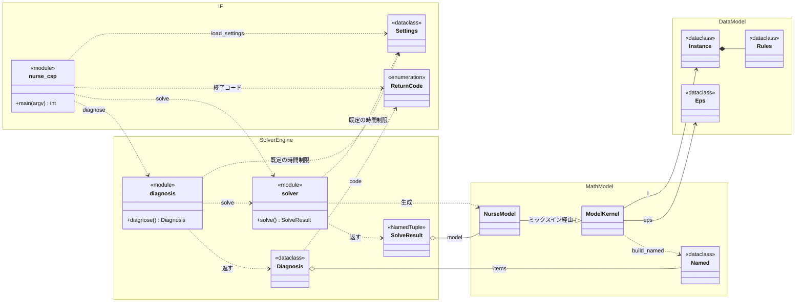
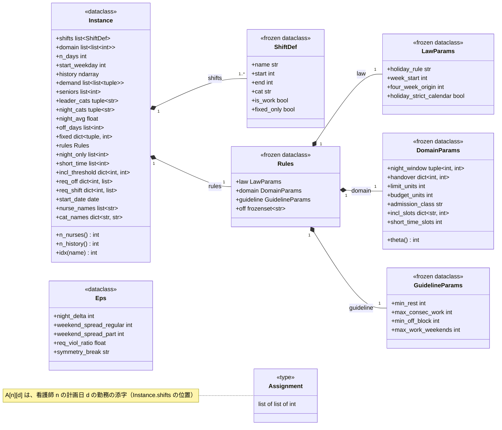
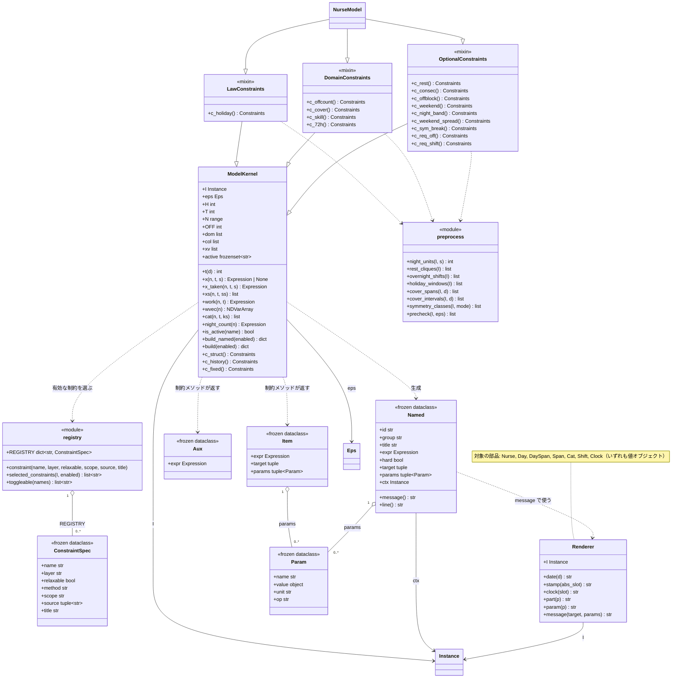
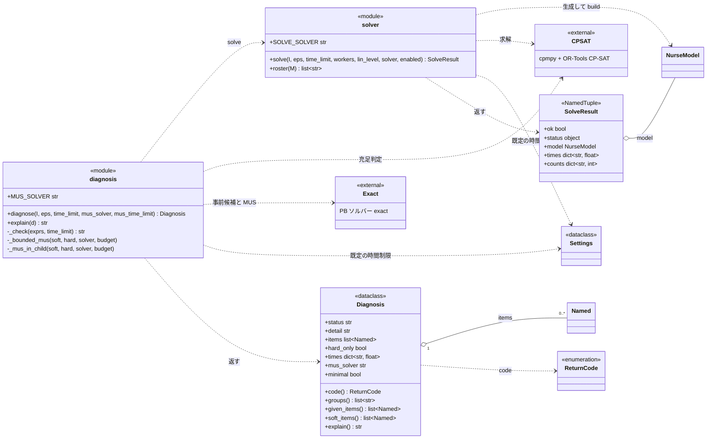
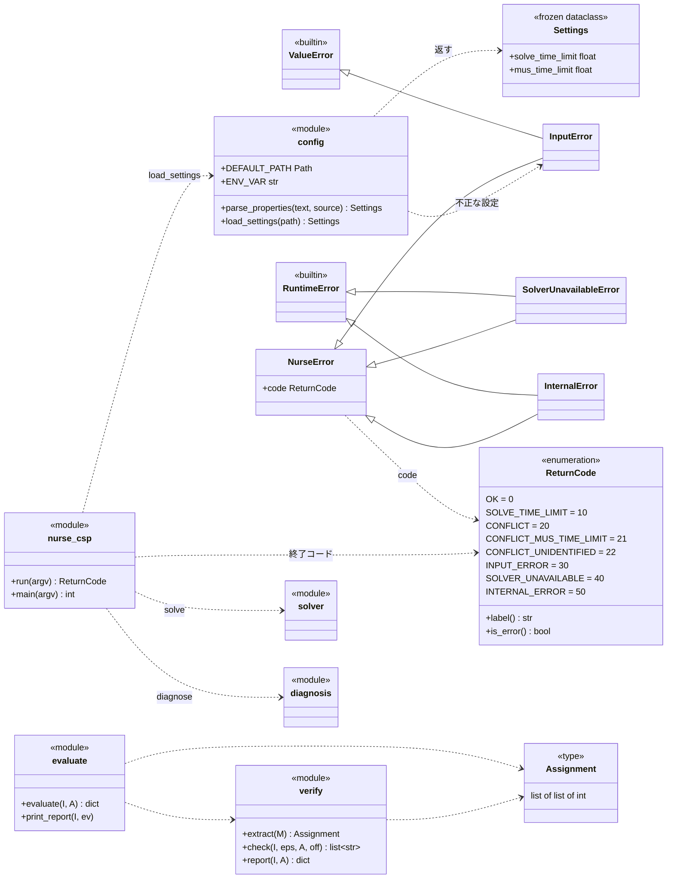

# クラス図（コア部分）

エンジンのコア部分を、**IF（入口・設定・戻り値）・データモデル・数理モデル・求解エンジン**の4つの領域に分けて、UML のクラス図（Mermaid）で示す。
モジュール間の依存は README 3.4 節、処理の流れ（シーケンス図）は README 3.1 節にある。

- 図は、`nurse/` と、トップレベルの `nurse_csp.py`・`verify.py`・`evaluate.py` のソースから取り出した名前（クラス・フィールド・メソッド・戻り値）に基づく。構成を変えたときは、この図も直す。`tests/test_docs.py` が、図とコードの一致を検査する。
- Python には UML のクラスにあたるもの以外（モジュール内の関数、データクラス、列挙型）があるので、ステレオタイプで区別する（下の凡例）。
- Mermaid の v10.9.1 と v11.17.2 で、5枚とも描画できることを確認している（GitHub が使う版は未確認）。

## 凡例

| 記法 | 意味 |
|---|---|
| `<<module>>` | モジュール。関数や定数の集まり（UML ではクラスの形で表す） |
| `<<dataclass>>` / `<<frozen dataclass>>` | データクラス（`frozen` は値を変更できない） |
| `<<enumeration>>` | 列挙型（`ReturnCode`） |
| `<<NamedTuple>>` | 名前つきタプル（`SolveResult`） |
| `<<mixin>>` | ミックスイン（機能を足すための継承用のクラス） |
| `<<external>>` / `<<builtin>>` | 外部ライブラリ / Python の組み込み |
| `<<type>>` | 型の別名（`Assignment`） |
| 白抜き三角の実線（`--|>`） | 継承（汎化） |
| 黒ひし形の実線（`*--`） | コンポジション（全体が部分を所有し、一緒に生成・破棄される） |
| 白ひし形の実線（`o--`） | 集約（部分を持つが、所有はしない） |
| 矢印の実線（`-->`） | 関連（フィールドとして持つ） |
| 矢印の破線（`..>`） | 依存（呼び出す・生成する・使う） |
| `1`・`0..*`・`1..*` | 多重度（個数の制約） |

括弧つきで示すメンバーのうち、`n_nurses`・`n_history`・`code`・`groups`・`given_items`・`soft_items`・`message`・`line`・`label`・`is_error` は、プロパティ（呼び出しに括弧は要らない）。

## 図1 全体像

4つの領域の主なクラスと、領域をまたぐ関係だけを示す。領域の名前は、`IF`（入口・設定・戻り値）・`DataModel`（データモデル）・`MathModel`（数理モデル）・`SolverEngine`（求解エンジン）。

- **IF** は、入口（`nurse_csp`）、設定（`Settings`）、結果の戻り値（`ReturnCode`）を持つ。
- **データモデル** は、入力データ `Instance`（層ごとの規則 `Rules` を持つ）と、ε 制約の閾値 `Eps`。
- **数理モデル** は、`Instance` と `Eps` から制約の式を作る。`NurseModel` は、`ModelKernel` を継承した3つのミックスイン（図3）を合成したクラス。制約は `Named`（ID・クラス名・メッセージ）にして返す。
- **求解エンジン** は、`solver.solve` が `NurseModel` を作って解き、`SolveResult` を返す。`diagnosis.diagnose` は、解けないときに `solve` を呼び、原因を `Diagnosis` にまとめる。

## 図2 データモデル

- `Instance` が入力のすべてを持つ。看護師・勤務・日付を整数の添字で表す（例: 勤務は `shifts` の位置）。
- `Instance` は、`ShiftDef` を複数（`shifts`）と、`Rules`（層ごとの規則のパラメータ）を1つ所有する。`Rules` は、`LawParams`（層1 労働法規）・`DomainParams`（層2 病院・看護職共通）・`GuidelineParams`（層3 努力義務）を所有し、`off`（外す制約名）を持つ。
- `Eps` は ε 制約の閾値で、`Instance` とは別に渡す。
- `Assignment` は解（割当表）の型で、`A[n][d]` が看護師 `n` の計画日 `d` の勤務の添字（`shifts` の位置）。

| `Instance` のフィールドの分類 | フィールド |
|---|---|
| 勤務 | `shifts`、`domain`（看護師ごとの取れる勤務の添字） |
| 計画 | `n_days`、`start_weekday`、`start_date`、`history`（前月末の実績）、`demand`（日別の需要区間 `(a, b, r)`。番ごとに一定で、1日を空きなく覆う） |
| 看護師の属性 | `seniors`（夜勤リーダー資格者）、`night_only`（夜勤専従者）、`short_time`（短時間正職員）、`incl_threshold`（72時間ルールの算入閾値の個別上書き）、`off_days`（公休数）、`nurse_names` |
| 規則・基準 | `rules`、`leader_cats`、`night_cats`、`night_avg` |
| 個別の入力 | `fixed`（固定割当）、`req_off`（休み要望。希望休を含む）・`req_shift`（シフト要望） |
| 表示 | `cat_names`（勤務区分名の上書き） |

## 図3 数理モデル

- **`ModelKernel`** は、決定変数 `x[n,t,s]`（`xv`。看護師 `n` の取れる勤務 `s` のみ作る疎な形）と、式の部品（`x`・`work`・`night_count` など）、常に有効な構造制約（`c_struct`・`c_history`・`c_fixed`）を持つ。`build_named` が、有効な制約ごとに `Named` の一覧を作り、`build` は式だけを返す（求解用）。
- **3つのミックスイン** `LawConstraints`（層1）・`DomainConstraints`（層2）・`OptionalConstraints`（層3）が、層ごとの制約メソッド（`c_` で始まる）を持つ。`NurseModel` は、3つを合成した（多重継承）クラスで、自分では何も定義しない。
- **登録の仕組み**: 制約メソッドは `@constraint` で `registry.REGISTRY`（制約名 → `ConstraintSpec`）に登録される。`selected_constraints` が、`Rules.off` と `enabled` を反映して有効な制約名を選ぶ。
- **制約の名前**: 制約メソッドは、式を `Item`（対象・パラメータつきの個別の規則）か `Aux`（補助変数の定義）で包んで返す。`build_named` が、全制約に ID を付けて `Named` にする。`Named.message` は、`Renderer`（日付・看護師名・区分名の表示方針を `Instance` から取る）が、診断のときだけ作る。
- `preprocess` は、窓・係数・集合を作る純 Python の関数群で、ソルバーに依存しない（`law`・`domain`・`optional` が使う）。

## 図4 求解エンジン

- **`solver.solve`** は、`NurseModel` を作って式を生成し、CP-SAT（外部）で解き、`SolveResult` を返す。`SolveResult.model` は、解の読み出しに使う `NurseModel`。時間制限の既定値は `Settings`（`nurse.properties`）から読む。
- **`diagnosis.diagnose`** は、`solve` を呼び、解けなければ原因（時間切れ / 制約矛盾）を調べる。矛盾なら、事前候補（コア）と MUS を exact（外部）で、時間制限つきで求める（`_bounded_mus`・`_mus_in_child`）。結果は `Diagnosis`。
- **`Diagnosis`** は、`items`（矛盾の原因の `Named`）、`minimal`（最小か。時間制限で打ち切ると `False`）、`code`（`ReturnCode`）を持つ。`explain()` が日本語で説明する。

## 図5 IF（入口・設定・戻り値）

- **`nurse_csp`**（CLI）は、`config.load_settings` で設定を読み、`solver.solve`・`diagnosis.diagnose` を呼び、`ReturnCode` を終了コードにする。
- **`config`** は、`nurse.properties`（Java 形式）を `Settings`（`solve_time_limit`・`mus_time_limit`）にする。不正な設定は `InputError`。
- **`ReturnCode`** は、0（正常）・10 台（時間打ち切り）・20 台（制約矛盾）・30 以上（異常）。例外は `NurseError` を基底とし、`InputError`（`ValueError` の一種）・`SolverUnavailableError`・`InternalError`（どちらも `RuntimeError` の一種）が、それぞれ対応するコードを持つ。
- **`verify`**（独立検証器）と **`evaluate`**（集計）は、解 `Assignment` を読む側で、モデルの式には依存しない。

## 図に含めないもの
`message` の部品（`Nurse`・`Day`・`DaySpan`・`Span`・`Cat`・`Shift`・`Clock`。図3 の注記のみ）、`solution` の関数、`synthetic`、`verify` の個別の検査関数、各クラスの非公開メソッド（`_` で始まるもの。図4 の `diagnosis` の主な内部関数を除く）。

## 用語
- **クラス図**: クラスの持つ値・操作と、クラス同士の関係を示す UML の図です。
- **ステレオタイプ**: `<<…>>` で書く、クラスの種類の注記です。
- **コンポジション・集約・関連・依存**: 関係の強さの順に、所有（一緒に生成・破棄される）、保持（所有はしない）、フィールドとして参照、使う（呼ぶ・生成する）です。
- **ミックスイン**: 他のクラスに機能を足すための継承用のクラスです。
- **MUS**: 同時には成り立たない制約の最小の集合です。
